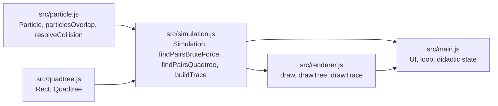
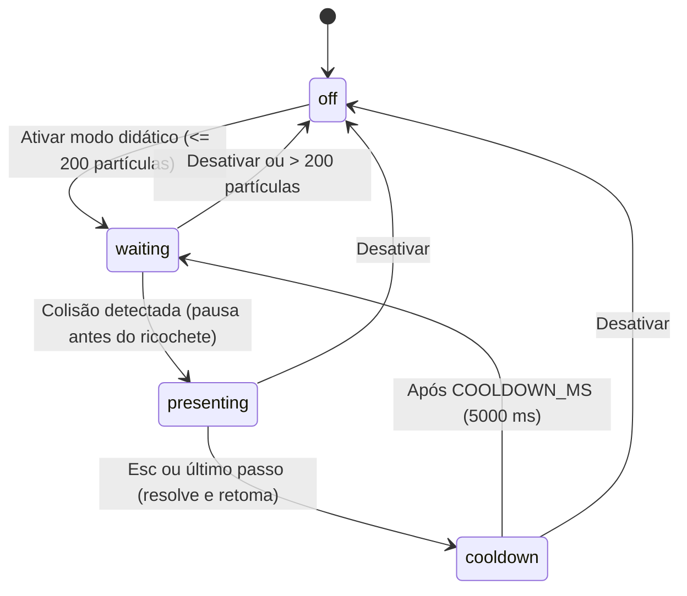

# Arquitetura do Sistema

O projeto é estruturado em **5 módulos JavaScript planos** sem dependências externas nem etapa de build, permitindo carregamento direto via `<script>` em `index.html` e execução isolada dos módulos de lógica pura em Node.js (`node --test`).

---

## Módulos em `src/`

| Módulo | Responsabilidade | Símbolos principais |
| :--- | :--- | :--- |
| [`src/particle.js`](../src/particle.js) | Estado da partícula, quique nas bordas e resposta elástica | `Particle`, `particlesOverlap()`, `resolveCollision()` |
| [`src/quadtree.js`](../src/quadtree.js) | Árvore espacial quaternária com limites de capacidade e profundidade | `Rect`, `Quadtree` (`capacity = 4`, `maxDepth = 8`) |
| [`src/simulation.js`](../src/simulation.js) | Ciclo do frame, detecção, seleção por região e geração de trace | `Simulation`, `findPairsBruteForce()`, `findPairsQuadtree()`, `buildTrace()` |
| [`src/renderer.js`](../src/renderer.js) | Desenho das partículas, grade da Quadtree, seleção, trace e gráfico de velocidade no Canvas 2D | `draw()`, `drawTree()`, `drawTrace()`, `drawSpeedChart()` |
| [`src/main.js`](../src/main.js) | Eventos de DOM (slider, `#countValue`, `#distribution`), mouse, teclado, `requestAnimationFrame` e controle didático | `loop()`, `restart()`, `applyCountNumber()`, `rebuildTrace()` |

---

## Máquina de estados do modo didático

Definida em `src/main.js`, coordena a pausa automática na primeira colisão detectada e o intervalo de cooldown de `5.000 ms`:

- **`off`**: simulação contínua sem pausas automáticas.
- **`waiting`**: animação ativa aguardando colisão; ao ocorrer, pausa antes de `resolve()` e gera o `trace` do frame.
- **`presenting`**: animação pausada com navegação por teclado (`→`, `←`, `Shift + →/←`, `Enter`, `Esc`). Cliques e arrastos no canvas são ignorados.
- **`cooldown`**: janela de 5 segundos após sair de `presenting` antes de armar a próxima pausa.

---

## Mapeamento estrutural (`/graphify`)

- **294 nós**, **417 arestas**, **25 comunidades** e **0 ciclos de importação** registrados em [`graphify-out/GRAPH_REPORT.md`](../graphify-out/GRAPH_REPORT.md).
- **Fronteira de testabilidade:** apenas `particle.js`, `quadtree.js` e `simulation.js` são importados por `tests/`, mantendo `renderer.js` e `main.js` isolados na camada de apresentação.
